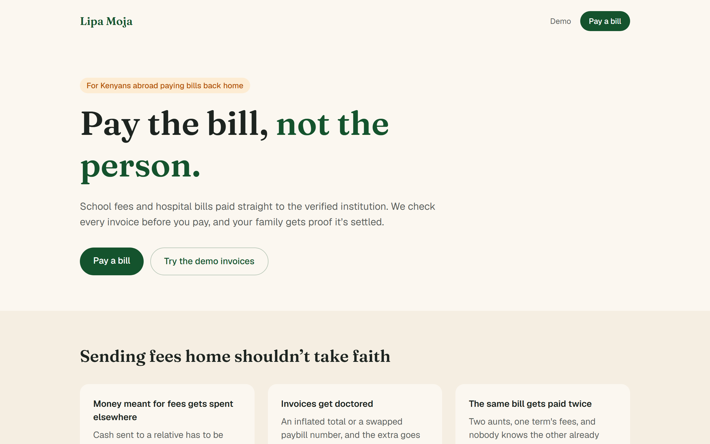
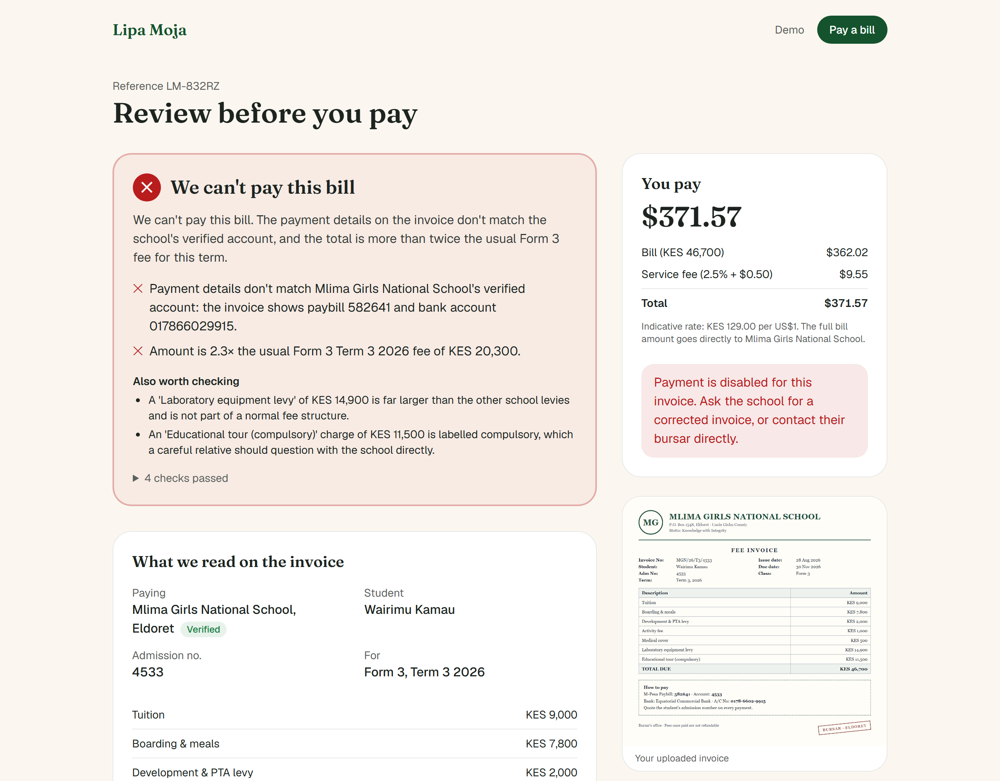
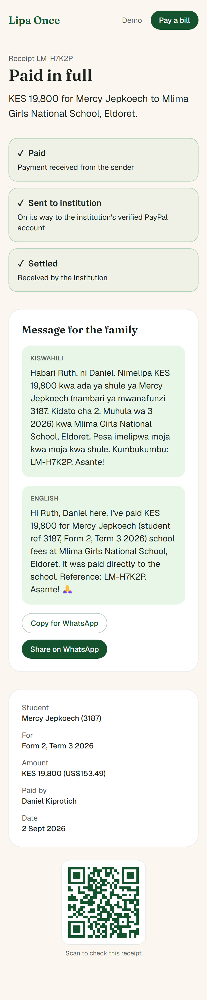
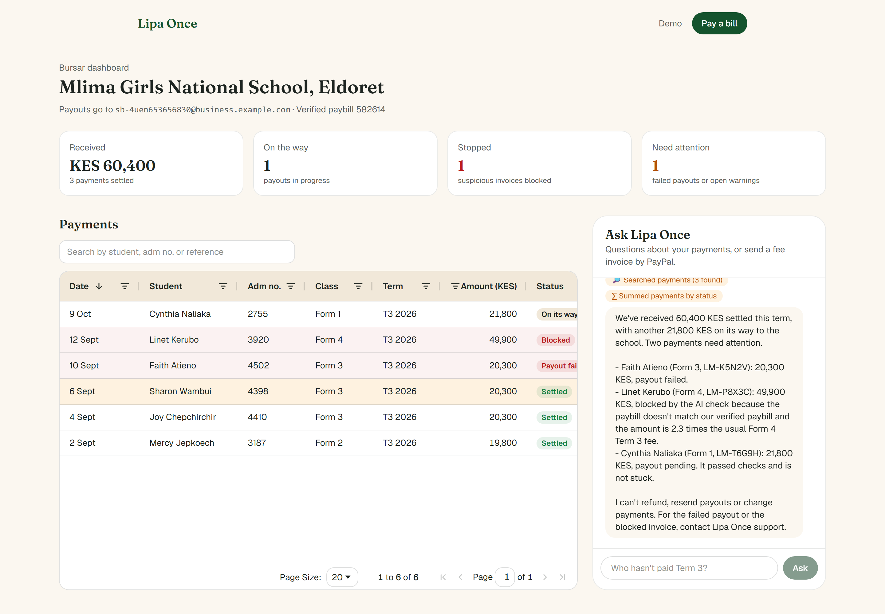

# Lipa Moja

**Diaspora money that pays the bill, not the person.** Upload a school fee invoice or hospital bill, let AI check it against a registry of verified institutions, pay in dollars with PayPal, and the money goes straight to the school. Your family gets a receipt in English and Swahili.

*Lipa moja* is Swahili for "pay once" or "pay directly".



## Try it

| | |
|---|---|
| **Live demo** | [lipa-once.onrender.com](https://lipa-once.onrender.com) |
| **Judges' shortcut** | [`/demo`](https://lipa-once.onrender.com/demo) runs the full flow on four sample invoices in one click |
| **PayPal sandbox buyer** | Email: `sb-rsw43u53638563@personal.example.com` · Password: `)JDz3aI!` (also shown on `/demo`) |
| **School dashboard** | [`/institution/mlima-girls-eldoret`](https://lipa-once.onrender.com/institution/mlima-girls-eldoret) · passcode `mlima2026` |

All schools, students, paybill numbers and payments are fictional. PayPal runs in sandbox mode, so no real money moves. The demo runs on Render's free plan, so the first visit after a quiet spell can take up to a minute while the server wakes up.

## The problem

Kenyans abroad send money home for specific bills: school fees, hospital bills, rent. Today that usually means sending cash to a relative and trusting them to carry it to the bursar. Too often:

- **The money is spent elsewhere.** It was meant for fees, but it never reaches the school.
- **The invoice is doctored.** The total is inflated, or the paybill number is swapped for someone else's.
- **The bill is paid twice.** Two relatives each pay the same term's fees without knowing.

## The solution

1. **Upload the bill.** A photo or PDF of the invoice the family sent.
2. **AI reads and verifies it.** Claude extracts every line. Deterministic rules then check the school against a verified registry, compare the paybill and bank account with the school's official ones, compare the amount with the school's fee schedule, and look for an earlier payment of the same bill. The result is **Approve**, **Flag** or **Block**, with every reason in plain English.
3. **Pay the institution directly.** The sender pays in USD with PayPal Checkout. Lipa Moja pays the bill amount to the school's verified PayPal account with PayPal Payouts. The relative never handles the money.
4. **Proof for the family.** Once PayPal confirms the payout, the family gets a WhatsApp-ready receipt in Swahili and English, with a link and QR code to check it.

| A doctored invoice is blocked | The family's receipt |
|---|---|
|  |  |

Schools get a bursar dashboard (built with AG Grid) showing every incoming payment, with blocked and flagged attempts highlighted. It also has an assistant that answers questions like "Which Form 3 students haven't paid for Term 3?" and can email a PayPal invoice to a guardian.



## How PayPal is used

| PayPal product | Where | What it does |
|---|---|---|
| **JS SDK v6** | Review page | One-time payment session behind the PayPal button. The order is created by our API when the sender clicks, so the amount always comes from the server. |
| **Orders v2** | `lib/paypal/orders.ts` | Creates a USD order itemised as bill plus service fee, with the Lipa Moja reference as `custom_id` and `invoice_id`, then captures it. |
| **Payouts v1** | `lib/paypal/payouts.ts` | Sends the bill amount (not the service fee) to the institution's verified PayPal account. The payment reference is the `sender_batch_id`, so PayPal itself rejects a second payout for the same bill. |
| **Webhooks** | `/api/paypal/webhook` | Every event is signature-verified and de-duplicated. `PAYMENT.CAPTURE.COMPLETED` triggers the payout, `PAYMENT.PAYOUTS-ITEM.*` settles or fails it, and `INVOICING.INVOICE.PAID` handles paid invoices. If webhooks can't arrive, polling of the Payouts and Invoicing APIs is the fallback. |
| **Invoicing v2** | `lib/paypal/invoices.ts` | The bursar assistant can email a PayPal invoice priced from the school's own fee schedule. A paid invoice flows into the same payout pipeline. |

## How AI is used

All AI calls use the Anthropic Claude API (`claude-sonnet-5-5`) with structured outputs validated by zod, and the server-side refusal fallback. If a call fails, the app shows a clear error and **never approves a payment**.

| Component | Where | What it does |
|---|---|---|
| **Invoice extraction** | `lib/ai/extract.ts` | A vision model reads the photo or PDF into a strict schema: institution, student, admission number, class, term, line items, total, paybill, bank account, a confidence score and legibility issues. It is told to extract only what is printed and to use `null` rather than guess. |
| **Verification review** | `lib/ai/explain.ts` | After the deterministic rules run, the model writes a short summary for the sender and can raise extra concerns, such as an unexpected "compulsory" levy. A concern can raise Approve to Flag; **nothing the AI says can lower a verdict**. |
| **Receipts** | `lib/ai/receipt.ts` | Writes a WhatsApp-style message of 60 words or fewer in English and Swahili. The output must keep the exact amount and reference, or a fixed bilingual template is used instead. |
| **Ask Lipa Moja** | `lib/ai/assistant.ts` | A tool-using agent for bursars with five tools, all scoped to that school: search payments, find students who haven't paid, totals, live payout status from PayPal, and sending a PayPal fee invoice. It has no refund or payout tools. |

### The verification rules

| Check | Result |
|---|---|
| Institution isn't in the verified registry | Block |
| Paybill or bank account differs from the school's official details | Block |
| Total is more than 2× the scheduled fee for that class and term | Block (more than 1.5×: Flag) |
| A settled payment exists for the same student and term | Block ("Already paid on 2 Sept 2026, ref LM-H7K2P") |
| Not a fee invoice or hospital bill | Block |
| Line items don't add up to the total | Flag |
| Blurry photo, low confidence, or legibility issues | Flag ("Please upload a clearer photo") |

The verdict is the most severe result. These rules are pure functions with unit tests covering all four sample invoices (`lib/verify.test.ts`).

## Architecture

```mermaid
flowchart LR
  S[Sender abroad] -->|upload invoice| P["/pay"]
  P --> API["POST /api/payments"]
  API --> X["Claude vision<br/>extraction"]
  X --> R["Rule checks<br/>registry, fees, history"]
  R --> E["Claude review<br/>summary + concerns"]
  E --> DB[(Postgres / SQLite<br/>via Prisma)]
  DB --> V["/pay/[id]<br/>verdict + quote"]
  V -->|PayPal JS SDK v6| O["Orders v2<br/>create + capture"]
  O --> PO["Payouts v1<br/>to school's PayPal"]
  PO -->|webhooks or polling| ST[SETTLED]
  ST --> RC["Claude receipt<br/>EN + SW"]
  RC --> F["/r/[reference]<br/>receipt + QR"]
  F -->|WhatsApp share| FAM[Family at home]
  DB --> D["/institution/[slug]<br/>AG Grid dashboard"]
  D --> AG["Ask Lipa Moja<br/>Claude + tools"]
  AG -->|Invoicing v2| INV[PayPal invoice]
  INV -->|INVOICE.PAID| PO
```



**Safety by design**

- Amounts are always computed on the server from the stored payment; the browser never sends a price.
- Money math uses integers only: whole shillings, and US cents as BigInt.
- Every status change is a guarded update (`VERIFIED → PAID → PAYOUT_PENDING → SETTLED`). The browser, webhooks and polling can race without paying a school twice. Integration tests in `lib/settlement.test.ts` cover this.
- Uploads are capped at 10 MB, and the file type is detected from the file's bytes.

## Run it locally

You'll need Node 20.19 or later.

```bash
git clone https://github.com/Keithclinton/Lipa-Once.git && cd Lipa-Once
cp .env.example .env          # then add your Anthropic and PayPal sandbox keys
npm install
npm run db:push && npm run db:seed
npm run dev                   # http://localhost:3000/demo
```

| Variable | Purpose |
|---|---|
| `ANTHROPIC_API_KEY` | Claude API key |
| `PAYPAL_CLIENT_ID`, `PAYPAL_CLIENT_SECRET`, `NEXT_PUBLIC_PAYPAL_CLIENT_ID` | PayPal sandbox REST app (enable Payouts and Invoicing) |
| `PAYPAL_WEBHOOK_ID` | Webhook subscribed to `PAYMENT.CAPTURE.COMPLETED`, `PAYMENT.PAYOUTS-ITEM.*` and `INVOICING.INVOICE.PAID` |
| `PAYOUT_EMAIL_<SLUG>` | Optional: route a school's payouts to your own sandbox business account |
| `SANDBOX_BUYER_EMAIL`, `SANDBOX_BUYER_PASSWORD`, `DASHBOARD_PASSCODE` | Shown on `/demo` for judges |

Without webhooks (for example on localhost), the receipt page polls PayPal directly, so payments still settle.

**Tests:** `npm test` runs the unit and integration tests. `npm run test:e2e` runs the Playwright smoke test; set `E2E_LIVE_AI=1` (with `ANTHROPIC_API_KEY` in `.env`) to include the live AI checks, or `E2E_BASE_URL` to point it at a deployment. `npm run samples` regenerates the sample invoices.

**Deploy:** `render.yaml` is a Render Blueprint (web service plus Postgres). On first boot it applies the schema and seeds the demo registry.

## Known limitations and the real-world path

- **Institutions onboard once.** Each school or hospital connects a verified PayPal business account and registers its official paybill, bank account and fee structure. In production this needs KYC and institution verification, for example against Ministry of Education registration. Here the registry is seeded.
- **Getting money to the school locally.** Schools receive USD in PayPal and withdraw to a Kenyan bank account. A production version would add a local payout rail.
- **Fixed exchange rate.** The KES to USD rate is a fixed indicative rate (`FX_KES_PER_USD`), shown on screen. Production would quote a live rate.
- **Receipts are shared, not sent.** Lipa Moja doesn't send WhatsApp messages or SMS; the sender shares the receipt with one tap.
- **Uploads use local disk.** Production would use object storage.
- **Senders don't have accounts.** A payment is identified by its reference, and bursar dashboards use a shared passcode.

## License

[MIT](LICENSE)
